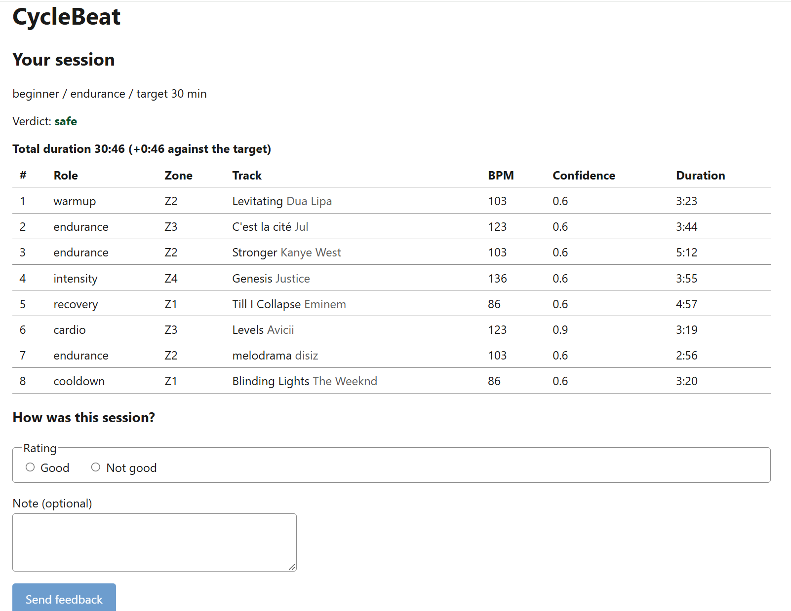
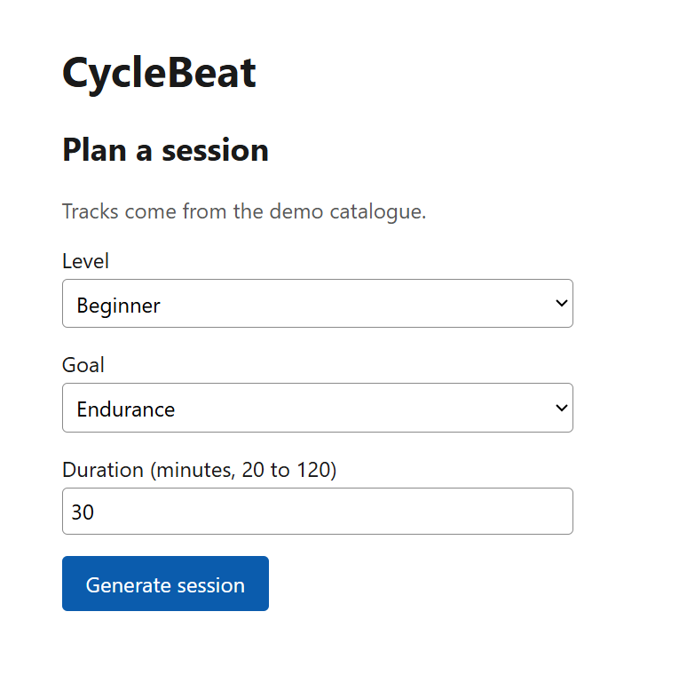
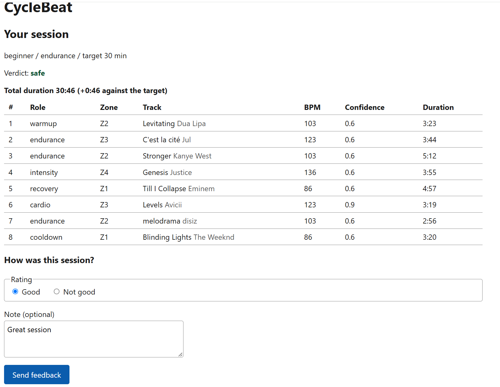
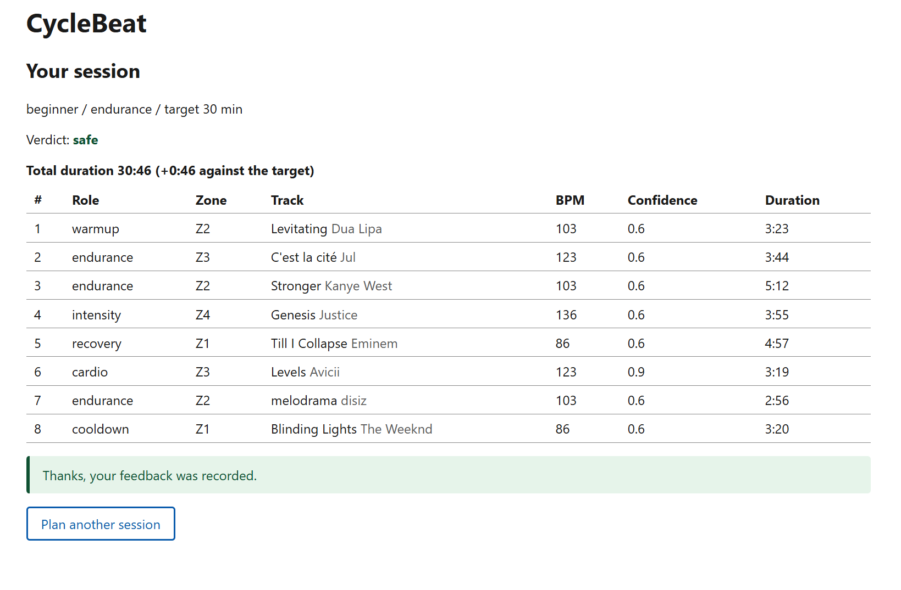
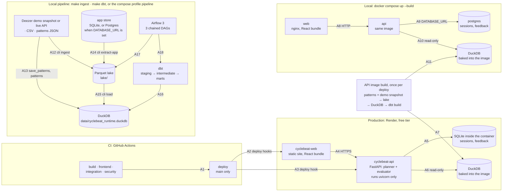

# 🚴 CycleBeat — music-to-workout data product

Your playlist becomes an indoor-cycling session: cadence, resistance and effort zone computed for every track.

- **The problem:** studio classes impose their playlist, and the instructor's.
- **The user:** an indoor cyclist, in a studio or at home, who wants to ride to their own music.
- **What the data checks:** how reliable each track's BPM is, and whether the session built from them is sound.

Under the hood it is a **data-engineering project first**: a multi-source ingestion pipeline,
a Parquet lake, a DuckDB warehouse modelled with dbt, a deterministic planning engine with its
own evaluator, and a contract-first API.

> **Status: submitted to the AI Dev Tools Zoomcamp 2026 and validated.** The submitted state is
> the tag `v1.0-submission` (commit 2b2b4f0). What follows is portfolio work: see the
> [Roadmap](#roadmap).
>
> **Live site:** <https://cyclebeat-web.onrender.com/> · **Live API:** <https://cyclebeat-api.onrender.com/> · interactive docs: <https://cyclebeat-api.onrender.com/docs>
> (`GET /health`, `POST /v1/sessions/generate` with the demo source). It runs on Render's free
> tier on a demo database baked into the image, which resets on every deploy ([ADR-003](docs/adr/adr-003-render-no-disk.md)); the free tier
> also spins down when idle, so the first request after a pause can be slow.
>
> CI and deployment run in GitHub Actions; Render deploys only on the pipeline's order, after green tests.

---

## Reviewer quick path

1. **Live.** Open <https://cyclebeat-web.onrender.com/> and generate a session, or call the
   API with the demo source (`/health` alone proves nothing about the data):

   ```bash
   curl -s -X POST https://cyclebeat-api.onrender.com/v1/sessions/generate -H 'content-type: application/json' -d '{"source": {"type": "demo", "value": ""}, "level": "beginner", "goal": "endurance", "duration_min": 30}'
   ```

2. **The full system locally, one command:** `docker compose up --build`, then open
   <http://localhost:4173> ([details](#the-full-system-one-command-docker)).
3. **Every test, one command:** `make test` (unit, then integration against the compose stack;
   needs `make setup` once and Docker running, see [Quality gates](#quality-gates)).
4. **How it was built:** the agent team and its hand-offs, [docs/agent-team.md](docs/agent-team.md);
   one entry per session, with what human review corrected, [docs/ai-workflow.md](docs/ai-workflow.md);
   the agents' instructions, [CLAUDE.md](CLAUDE.md).

## Rubric map

One row per criterion of the official grid, verbatim in
[docs/grading-criteria.md](docs/grading-criteria.md) (re-checked against the course repository on
24 November 2026: unchanged since commit 526d9c1). Evidence levels, the old 30-point grid and what
is missing: [docs/quality-bar.md](docs/quality-bar.md), whose state is dated 22 October 2026.
This map was checked against `main` at 66fdab9.

| # | Criterion | Where to look | In one line |
|---|---|---|---|
| 1 | Problem Description | the opening lines of this page, [Why this project](#why-this-project) | The problem, the user, what the system does and how a session is judged |
| 2 | Product Specification | [product-spec.md](product-spec.md), the [GitHub issues](https://github.com/elliepsc/cyclebeat/issues) | FR/NFR with acceptance criteria; one issue per block, the agent's plan commented on it before coding |
| 3 | Agent Team Specification | [docs/agent-team.md](docs/agent-team.md), [.claude/agents/](.claude/agents/) | The owner, the main agent and four subagents, their triggers and hand-offs |
| 4 | Context Management | [AGENTS.md](AGENTS.md), [CLAUDE.md](CLAUDE.md) | Both point to modular docs: roadmap, ADRs, permissions, agent team |
| 5 | Application | [Run it locally](#run-it-locally), [docker-compose.yml](docker-compose.yml) | React → FastAPI → Postgres, one command |
| 6 | Testing | [Quality gates](#quality-gates), [tests/](tests/), [tests/integration/](tests/integration/) | `make test`: unit, then integration over HTTP |
| 7 | Containerization | [Dockerfile](Dockerfile), [docker-compose.yml](docker-compose.yml) | postgres, api and web with chained healthchecks, one command |
| 8 | Deployment | the live URLs above, [render.yaml](render.yaml) | API and site on Render's free tier |
| 9 | CI/CD | [.github/workflows/ci.yml](.github/workflows/ci.yml), [tools/deploy.py](tools/deploy.py) | CI on every push; CD deploys to production after green CI on `main`. No dev environment and no manual production step (the 3-point level) |
| 10 | Observability | [monitoring/](monitoring/) | Partial: `/metrics` exposed by the API everywhere; Prometheus and Grafana in a local compose profile; no traces, no structured logs sharing a trace ID |
| 11 | Alerting on User Impact | — | **Missing:** no alert rule |
| 12 | On-Call Agent | — | **Missing:** no agent woken by an alert |

## What it looks like

**What "safe" means.** It is the evaluator's verdict when the session passes every check of
[ADR-007](docs/adr/adr-007-session-construction-rules.md). Four of them are blocking: a Z1 or Z2
warmup of at least 180 s, a Z1 cooldown of at least 120 s, no Z5 in the first 300 s, and a BPM on
every track. The planner never builds a session that breaks one of them; when the catalogue does not
hold two distinct tracks to serve as the cooldown (Z1, at least 120 s) and the warmup (Z1 or Z2, at
least 180 s), the API refuses with HTTP 422. Any other failing check (duration within 120 s of the
target, level and goal caps, at most two hard segments in a row, recovery after a hard segment, BPM
coverage) gives the verdict `review` instead. The thresholds come from the project's v1 notes, which
ADR-007 presents as ordinary indoor-cycling practice; no sports or medical reference is cited, and
they are not medically validated.

The generated session: the evaluator's verdict, then one row per track with its role, zone, BPM,
BPM confidence and duration, and the form to rate the session:



It starts from a level, a goal and a duration:



Once generated, the session can be rated, with an optional note:



Once sent, the rating is recorded:



Screenshots taken by the owner, in a browser, on 25 October 2026.

## Why this project

Indoor-cycling classes tie riders to a fixed playlist and a fixed instructor. CycleBeat starts from
the rider's own music. The hard part is not the UI: it is getting a **reliable BPM** for mainstream
tracks now that the Spotify audio-analysis endpoints are closed to new apps, and turning those BPMs
into a session that is **coherent and safe**.

## Architecture



**How the parts fit together.** The browser loads a React bundle that was built with the
API's URL baked in. It then talks to a FastAPI service, which plans and checks a session
from the track catalogue and stores the session and its feedback in a transactional store.
The catalogue and the quality KPIs come from a DuckDB warehouse that the API opens read-only.
**In production that warehouse is built once, when the API image is built,** from versioned
files only. The container then runs uvicorn alone, so nothing re-extracts at runtime: the
sessions created on the live site stay in the container's SQLite file, never reach a mart, and
are lost at the next deploy ([docs/metrics.md](docs/metrics.md#where-the-data-comes-from-and-which-window-it-covers),
[ADR-003](docs/adr/adr-003-render-no-disk.md)). Locally, `docker compose up --build` runs the
same API image against Postgres, behind an nginx copy of the front. The compose API reads the
warehouse baked into its image, not the host's. The pipeline (ingest → lake → DuckDB → dbt,
orchestrated by Airflow) is a separate, opt-in path that writes the host's `lake/` and `data/`.
CI runs the test jobs on every push. On `main`, once they are green, it triggers Render's
deploy hooks and smoke-tests the live services; Render deploys nothing on its own.

Every box and arrow above, with its source in the code: [docs/architecture.md](docs/architecture.md).

### The stack, and where each tool runs

Production is the Render deployment; "locally" means a developer's machine or CI.

- **React + Vite + TypeScript:** the site; in production a Render static site, locally an nginx container under compose.
- **FastAPI (uvicorn):** the API, which plans and evaluates sessions; runs in production.
- **SQLite:** the sessions-and-feedback store in production, inside the container, lost at each deploy ([ADR-003](docs/adr/adr-003-render-no-disk.md)).
- **Postgres:** the same store under compose and in CI; not in production.
- **DuckDB:** the analytical warehouse; in production, built into the API image and opened read-only.
- **dbt:** staging → intermediate → marts; in production it runs once, when the API image is built, never at runtime.
- **dlt:** loads the cycling-patterns knowledge base; runs at image build and in the local pipeline.
- **Deezer API:** track identity, the 30 s preview and an optional `bpm` field; called live only locally (`cli ingest --live`); production and CI read the committed snapshot.
- **librosa:** BPM from the Deezer preview; demonstrated locally (an optional `audio` extra, not in the image), not in production, which serves the BPMs of the committed snapshot.
- **Airflow 3:** orchestration of the three DAGs, demonstrated locally (compose profile `pipeline`), not in production.
- **Prometheus + Grafana:** the API exposes `/metrics` in every environment, production included; the Prometheus server and Grafana that collect and show it are demonstrated locally (compose profile `monitoring`), not in production.
- **Docker and Docker Compose:** the API image runs in production on Render; Compose runs the full system locally and in CI.
- **GitHub Actions:** the tests on every push, then the production deploy from `main`.
- **Semgrep and gitleaks:** blocking security scans in CI.
- **MCP server:** read-only warehouse tools for a coding agent, used locally only ([docs/agent-extension-pack.md](docs/agent-extension-pack.md)).

The BPM resolution (librosa on the Deezer preview, cross-validated with Deezer's `bpm`) is
described in [ADR-005](docs/adr/adr-005-deezer-preview-backbone.md) and
[ADR-010](docs/adr/adr-010-track-and-bpm-sources.md). Monitoring (Prometheus + Grafana,
`monitoring/`) is the opt-in compose profile `monitoring`. Every KPI the marts expose, with its
grain, formula and guarding tests: [docs/metrics.md](docs/metrics.md).

## Key design decisions

| Decision | Why | ADR |
|---|---|---|
| BPM from `librosa` on the Deezer preview, Deezer `bpm` field as cross-validation | Spotify audio features are closed to new apps; librosa returned a usable BPM for 41 of 50 tracks (82 %): 30 current Deezer chart tracks + 20 hand-picked classics; the spike itself calls this a small sample and expects the real-world rate below 82 % ([spike report](docs/spikes/phase1-source-coverage.md)) | [ADR-005](docs/adr/adr-005-deezer-preview-backbone.md) |
| A confidence score on every BPM (`cross_validated` 0.9, `single_source` 0.6) | The planner must know how much to trust each track | [ADR-005](docs/adr/adr-005-deezer-preview-backbone.md) |
| Deterministic planner, no LLM in the core | Cadence and effort must be computed, not generated | [ADR-007](docs/adr/adr-007-session-construction-rules.md) |
| Evaluator validated by a **mutation check** | An evaluator tested on the planner's own output proves nothing | [ADR-007](docs/adr/adr-007-session-construction-rules.md) |
| `openapi.yaml` written by hand before the backend | The contract drives the code, and CI checks they never diverge | — |
| Postgres for app state (sessions, feedback), DuckDB for analytics | OLTP and OLAP have different jobs | [ADR-009](docs/adr/adr-009-postgres-transactional-duckdb-analytical.md) |

All decisions: [docs/adr/](docs/adr/README.md).

**Where sessions and feedback are stored.** Postgres when `DATABASE_URL` is set (the compose
stack sets it), SQLite at `data/cyclebeat_app.db` otherwise, so a clean clone runs with no
service. Choosing the engine from the URL is unit-tested, and the Postgres code path is exercised
in CI against a real database (a `postgres:16-alpine` service; the repository tests run on both
engines, and are skipped locally unless `TEST_DATABASE_URL` points at a server). Postgres is
the store under compose and in CI. The public demo sets no `DATABASE_URL` and has no persistent
disk ([ADR-003](docs/adr/adr-003-render-no-disk.md)): it keeps sessions in SQLite inside its
container, so a session created there survives neither a redeploy nor a restart of the service,
including the free tier's spin-down when idle.

## Quality gates

[](https://github.com/elliepsc/cyclebeat/actions/workflows/ci.yml)

Every check below runs in CI on every push. Counts are in each PR description, not here.

| Check | Command | What it covers |
|---|---|---|
| Lint, strict typing, dead links | `make lint` · `make typecheck` | ruff, strict mypy, relative Markdown links |
| Unit then integration, one command | `make test` | `make test-unit`, then `make test-integration`; stops at the first failing suite and names it; fails (never skips) without Docker; CI runs its two halves in separate jobs (`make test-unit`, `make test-integration`) |
| Unit tests | `make test-unit` | everything under `tests/` except `tests/integration/`, including the API contract suite |
| Evals | `make eval` | adversarial playlists and the planner **mutation check** |
| dbt models and data tests | `make dbt` | staging → intermediate → marts, and the data tests |
| API contract | `make contract` | `openapi.yaml` vs the schema FastAPI generates, plus schemathesis against the real app |
| Integration (end to end) | `make test-integration` | the compose stack (api, web, postgres) driven over HTTP — see [End-to-end tests](#end-to-end-tests) |
| Security scans | `make audit` | Semgrep (blocking on severity ERROR) and gitleaks over the whole git history (blocking on any finding), Docker images pinned by digest — see [Security & ops](#security--ops) |

## Run it locally

### The full system, one command (Docker)

Requires Docker with Compose v2 (on Windows: Docker Desktop with WSL integration, see
[CONTRIBUTING.md](CONTRIBUTING.md)). No `.env` to fill in, no key, no network at run time.

```bash
git clone https://github.com/elliepsc/cyclebeat.git && cd cyclebeat
docker compose up --build
```

| Service | URL | What it is |
|---|---|---|
| `web` | <http://localhost:4173> | the React app (nginx), built against the compose API |
| `api` | <http://localhost:8000> — docs at `/docs` | FastAPI, serving the demo warehouse baked into its image |
| `postgres` | not published (`docker compose exec postgres psql -U cyclebeat`) | sessions and feedback |

Each service has a healthcheck, and starts only once the one it depends on is healthy
(`postgres` → `api` → `web`); `docker compose ps` shows `(healthy)` on all three when ready.
Open <http://localhost:4173>, pick a level, a goal and a duration, and generate a session.
Stop with `Ctrl+C`, then `docker compose down -v` to drop the Postgres volume too.

- **Observed on the maintainer's machine** (WSL2, Docker 27.5, base images already pulled):
  building both images without cache took 70 s, and the three services were healthy about
  22 s after `up`. A first run also downloads the base images (Python, Node, nginx,
  Postgres), which depends on your connection.
- **Ports.** 8000 and 4173 by default. If one is taken, pin another and rebuild — the web
  bundle bakes the API URL in at build time, and the API's CORS list follows the same
  variables: `CYCLEBEAT_API_PORT=9000 CYCLEBEAT_WEB_PORT=5000 docker compose up --build`.
  `make compose-up` picks free ports for you and prints them.
- **Open the app at `localhost` or `127.0.0.1`**: both origins are allowed by CORS.
- **Values in `docker-compose.yml` are local defaults, not secrets** (the Postgres password
  opens a container with no published port). Production uses none of them.

**Deliberately outside the default stack.** The data pipeline (ingest → lake → DuckDB → dbt)
and its Airflow orchestrator are not needed to run the app: the API image builds the demo
warehouse itself, from versioned files only ([ADR-003](docs/adr/adr-003-render-no-disk.md)).
They also **write to your working copy's `data/` and `lake/`** (bind mounts), which the default
stack never does. They are opt-in compose profiles:

```bash
docker compose --profile pipeline up --build     # ingest + dbt, then Airflow on :8080
docker compose --profile monitoring up --build   # Prometheus on :9090, Grafana on :3000
```

### End-to-end tests

`tests/integration/` is a black-box suite: it only talks HTTP to a running compose stack, and
is kept out of `make test-unit`. One command builds the stack, waits until all three services
are healthy (bounded wait), runs the suite, prints the service logs on failure, and always
tears everything down, volumes included:

```bash
make setup              # once: installs pytest from uv.lock
make test-integration   # non-zero exit status if anything fails
```

- It runs as its own compose project, `cyclebeat-it`, so it neither collides with nor wipes a
  stack you already have running (it does need ports 8000 and 4173 free, or
  `make test-integration IT_API_PORT=… IT_WEB_PORT=…`).
- Covered: health; generate a demo session, replay it, find it in the list, rate it (and a
  404 on an unknown session); the two data-quality reads; the web bundle points at the compose
  API; CORS lets the web origin in and keeps a foreign one out; and a session survives a
  recreate of the API container, which only holds because it lives in Postgres.
- **A missing stack fails, it never skips.** The suite only accepts `localhost`, `127.0.0.1`
  or `::1` as a target and refuses any other URL before the first request, so it can never
  run against the public deployment.
- Observed from a fresh clone (images already built, so no compile): 13 tests passed, 35 s for
  the whole command, 8.8 s of it in pytest. CI runs the same command in the `integration`
  job, and the deployment waits for it; its first run, building both images from scratch,
  took 1 min 11 s ([run 38151120398](https://github.com/elliepsc/cyclebeat/actions/runs/38151120398)).

### Without Docker

Requires [uv](https://docs.astral.sh/uv/).

```bash
make setup      # installs the exact pinned environment (uv.lock)
make ingest     # loads the committed demo knowledge base (no network, no API key)
make dbt        # builds the warehouse
make api        # API on http://localhost:8000 — docs at /docs
```

Frontend (React + Vite, in `frontend/`). It needs the Node version pinned in
`frontend/.nvmrc`, and `make api` running in another terminal.

```bash
make front        # dev server on http://localhost:5173 (installs from the lockfile first)
make front-test   # vitest
make front-gen    # regenerate the TypeScript client from openapi.yaml
```

- The API URL is `VITE_API_URL`, fixed at build time (default `http://localhost:8000`).
- The API only answers browsers whose origin is listed in `CORS_ALLOW_ORIGINS`
  (comma-separated, never `*`; default `http://localhost:5173`).
- `frontend/src/api/schema.d.ts` is generated from `openapi.yaml`, never edited by hand: CI
  regenerates it and fails if the committed file differs.

Docker variants: `make compose-up` (the full system, free ports picked for you),
`make compose-pipeline` (plus ingest, dbt and Airflow), `make compose-monitoring`.
WSL setup and the branch/PR workflow: [CONTRIBUTING.md](CONTRIBUTING.md).

## API

| Method | Endpoint | Purpose |
|---|---|---|
| `GET` | `/health` | Liveness |
| `POST` | `/v1/sessions/generate` | Plan a session from the catalogue |
| `GET` | `/v1/sessions` · `/v1/sessions/{id}` | List and replay sessions |
| `POST` | `/v1/sessions/{id}/feedback` | Rate a session |
| `GET` | `/v1/quality/coverage` · `/v1/quality/summary` | BPM coverage and data-quality KPIs from the marts |

## Roadmap

| Phase | Content | Status |
|---|---|---|
| 0–1 | Purge of the v1 prototype, source spike | ✅ |
| 2 | Data-engineering core: resolver, lake, DuckDB, dbt, Airflow | ✅ |
| 3 | Planner + evaluator, mutation check | ✅ |
| 4 | Contract-first API | ✅ |
| 5 | Frontend (React, client generated from `openapi.yaml`) | ✅ |
| — | Public deployment (API) | ✅ |
| 7 | Agent extension pack (MCP server, hook, subagents, skill, plugin) | ✅ |
| 10 | Security, audit and DevOps (criterion 13) | ✅ (PR #42) |
| 6 | Bounded warehouse copilot (LLM layer) | planned |

Feedback ratings and notes are stored and reach the marts, but the planner never reads them; next phase: ratings adjust the thresholds.

Detailed roadmap: [docs/ROADMAP.md](docs/ROADMAP.md).

## Security & ops

| What | Where |
|---|---|
| Index of the security artifacts | [security/README.md](security/README.md) |
| PR audits (raw reviewer output and triage) | [security/pr-audits/](security/pr-audits/pr-38.md) |
| Scan findings (Semgrep, gitleaks, pip-audit, npm audit), triaged | [security/scans/2026-10-20.md](security/scans/2026-10-20.md) |
| Agent and extension security: threat model, bypasses fixed, what remains | [security/agent-security.md](security/agent-security.md) |
| AI tool and data policy | [security/ai-policy.md](security/ai-policy.md) |
| Operational diagnosis: Postgres down while the API reports healthy | [ops/](ops/README.md) |
| What a coding agent may do here, and the guardrails | [docs/permissions.md](docs/permissions.md) |

## How it was built

What the system must do, requirement by requirement, with the PRs and tests that prove each one:
[product-spec.md](product-spec.md). Remaining work: the [GitHub issues](https://github.com/elliepsc/cyclebeat/issues),
one per block, each closed by the pull request that delivers it.

Developed with AI coding agents under explicit rules: project instructions (`AGENTS.md`,
`CLAUDE.md`), dedicated subagents (`.claude/agents/`: contract guardian, dbt reviewer,
security auditor), one phase = one branch = one pull request, and CI as the definition of done.
The decisions taken — including the ones taken *against* an agent's proposal — are logged in
[docs/ai-workflow.md](docs/ai-workflow.md).

---

*The v1 prototype (LLM Zoomcamp capstone: Spotify, Qdrant, LangGraph) is preserved on the
`archive/v1-llm-zoomcamp` branch.*

**License:** MIT. See [LICENSE](LICENSE).
